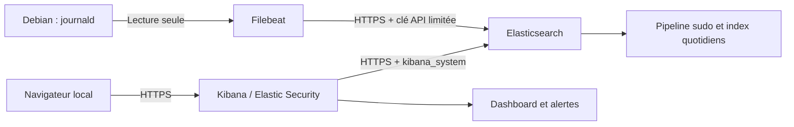
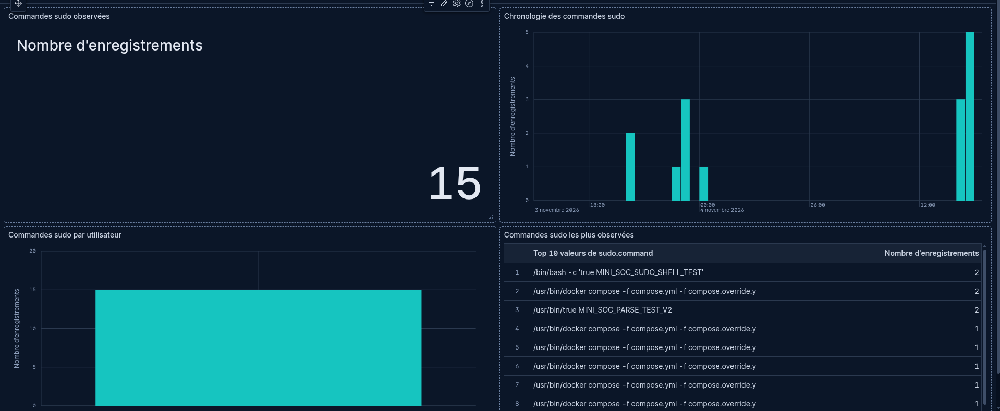

# Mini-SOC — Authentification Linux et détection sudo

Laboratoire de supervision sécurité sur Debian 13, construit avec
Elasticsearch, Kibana, Elastic Security et Filebeat 9.5.6.

Le projet collecte les événements d’authentification de journald, structure
les messages de commande sudo et détecte le lancement de certains shells
avec root comme utilisateur cible. Il inclut un dashboard, une règle
exportable et un rapport de validation avec tests positif et négatif.

## Architecture



- Elasticsearch : `https://localhost:9200`.
- Kibana : `https://localhost:5601`.
- Les ports sont publiés uniquement sur `127.0.0.1`.
- Le transport entre nœuds Elasticsearch reste sur la boucle locale du
  conteneur ; le cluster comporte un seul nœud.
- SSH n’est pas nécessaire pour le scénario sudo validé.

## Fonctionnalités validées

| Fonction | Résultat |
|---|---|
| Lecture des journaux Debian depuis Filebeat | Validée |
| HTTPS et authentification Elasticsearch/Kibana | Validés |
| Clé API de collecte limitée à `mini-soc-auth-*` | Validée |
| Extraction des champs sudo | Validée |
| Détection d’un shell root via sudo | Alerte produite |
| Commande sudo ordinaire | Collectée, sans alerte correspondante |
| Triage de l’alerte | Clôture `benign_positive` |
| Dashboard | Quatre panneaux exportés |

La règle est associée à **MITRE ATT&CK T1548.003 — Sudo and Sudo Caching**,
dans la tactique Privilege Escalation. Une correspondance ne suffit pas à
établir une intention malveillante.

## Aperçu du dashboard



Capture du 4 novembre 2026 : 15 événements de commande sudo sur la période
affichée. Ce compteur représente les événements collectés, pas le nombre
d’alertes. Les quatre panneaux présentent le compteur, la chronologie,
la répartition par utilisateur et un tableau des commandes les plus observées.

## Ressources et prérequis

Machine du laboratoire : 8 Go de RAM, quatre cœurs CPU et environ 47 Go
libres avant téléchargement des images. Les images et les données
consomment une partie de cet espace.

| Service | Plafond RAM | Réglage du tas | Quota CPU |
|---|---:|---|---:|
| Elasticsearch | 3 Gio | Java : 1 Gio | 2 |
| Kibana | 2 Gio | Node.js : ancienne génération de 1 Gio | 2 |
| Filebeat | 512 Mio | Réglage par défaut | 0,5 |

Les plafonds ne sont pas des réservations immédiates. Les quotas CPU
peuvent se partager les quatre cœurs de l’hôte. Fermer les applications
lourdes et surveiller la mémoire disponible pendant les tests.

Kibana a échoué au redémarrage avec un tas limité à 768 Mio :
`JavaScript heap out of memory`, code de sortie `134`. La configuration
actuelle utilise un tas de 1024 Mio et un conteneur de 2 Gio.

Prérequis :

- Debian 13, Docker Engine et Docker Compose fonctionnels.
- OpenSSL et curl ; Python 3 pour les contrôles JSON ci-dessous.
- Journaux persistants présents dans `/var/log/journal`.
- `vm.max_map_count` égal ou supérieur à `1048576`.
- Versions définies dans `.env` à partir de `.env.example`.

Contrôles sans modification :

```bash
docker compose version
cat /proc/sys/vm/max_map_count
free -h
df -h .
sudo du -sh /var/log/journal
```

## Organisation du dépôt

```text
compose.yml                         Elasticsearch
compose.override.yml                Kibana
compose.filebeat.yml                Filebeat
.env.example                        Version publique de la stack
configs/
  elasticsearch.yml
  kibana.yml
  kibana.node.options
  filebeat.yml
  ilm/mini-soc-auth-7d.json
  component-templates/mini-soc-auth-fields.json
  index-templates/mini-soc-auth.json
  ingest-pipelines/mini-soc-auth-v1.json
dashboards/
  mini-soc-activite-sudo.ndjson
detection-rules/
  mini-soc-sudo-root-shell.ndjson
incident-reports/
  IR-001-sudo-root-shell.md
```

## Fichiers locaux nécessaires

Les commandes de démarrage supposent que les certificats et secrets ont
déjà été provisionnés. Un clone Git seul ne suffit pas à initialiser une
nouvelle installation : ce dépôt ne contient pas encore de script complet
de création des certificats, comptes et keystores.

Les éléments locaux exclus de Git comprennent :

| Élément | Usage |
|---|---|
| `.env` | `STACK_VERSION=9.5.6` |
| `docker/certs/ca/ca.crt` | Vérification TLS depuis Debian et Filebeat |
| `docker/certs/ca/ca.key` | Signature des certificats ; jamais montée dans les services |
| `docker/certs/elasticsearch/` | Certificat, clé et copie de la CA pour Elasticsearch |
| `docker/certs/kibana/` | Certificat, clé et copie de la CA pour Kibana |
| `configs/secrets/elastic_password` | Mot de passe administrateur |
| `configs/secrets/kibana_password` | Mot de passe du compte technique `kibana_system` |
| `configs/secrets/kibana/kibana.keystore` | Mot de passe technique et clés de chiffrement Kibana |
| `configs/secrets/filebeat_api_key` | Copie locale de la clé de publication, au format `id:api_key` |
| Volume `mini-soc_filebeat_data` | Keystore Filebeat et curseur de lecture |

Le keystore Kibana contient `elasticsearch.password` et les clés
`xpack.security.encryptionKey`, `xpack.encryptedSavedObjects.encryptionKey`
et `xpack.reporting.encryptionKey`. Le keystore Filebeat contient
`FILEBEAT_API_KEY`. Conserver ces éléments dans une sauvegarde privée
protégée. Les keystores de ce laboratoire n’ont pas de mot de passe
supplémentaire : leurs permissions restent essentielles.

Les certificats serveur autorisent les noms Docker des services,
`localhost` et `127.0.0.1`. Le navigateur doit faire confiance au certificat
public de la CA pour accéder à Kibana sans avertissement.

Filebeat utilise explicitement `host.name: white-hat`. Adapter cette valeur
avant de déplacer le collecteur sur une autre machine.

### Permissions importantes

- Dossiers `docker/certs` et `configs/secrets` privés pour le propriétaire.
- Sous-dossiers de certificats des services : groupe `0`, mode `750`.
- Certificats et clés montés dans Elasticsearch/Kibana : groupe `0`, mode `640`.
- Keystore Kibana : groupe `0`, mode `640`.
- Certificat public `docker/certs/ca/ca.crt` : mode `644`, afin que Filebeat
  puisse le lire sans capacités Linux supplémentaires.
- Clé privée de la CA et fichiers de mots de passe : mode `600`.
- Configuration Filebeat : propriétaire `root:root`, mode `644`.

Le certificat public de la CA n’est pas un secret. Sa clé privée en est un.

## Démarrer et arrêter le laboratoire existant

Depuis la racine du dépôt, définir ce raccourci dans le terminal courant :

```bash
dc() {
  sudo docker compose \
    -f compose.yml \
    -f compose.override.yml \
    -f compose.filebeat.yml "$@"
}
```

Il inclut explicitement les trois services. Le fichier Filebeat n’est pas
chargé par défaut avec un simple `docker compose`.

Vérifier la configuration, puis démarrer :

```bash
dc config --quiet
dc up -d --wait --wait-timeout 300
dc ps -a
```

Le contrôle de santé Elasticsearch attend une réponse HTTPS `401` sans
identifiants. Celui de Kibana attend le succès de `/api/status`. Filebeat
n’a pas de contrôle de santé Compose ; son état `Running` ne garantit pas
l’arrivée des événements.

Vérifier Kibana :

```bash
curl --silent --show-error \
  --connect-timeout 5 --max-time 15 \
  --cacert docker/certs/ca/ca.crt \
  --output /dev/null \
  --write-out 'Code HTTP Kibana : %{http_code}\n' \
  https://localhost:5601/api/status
```

Résultat attendu : `200`. Ouvrir ensuite `https://localhost:5601` depuis
le PC Debian. Le compte `kibana_system` sert au serveur, pas à la connexion
dans le navigateur. Le laboratoire utilise actuellement `elastic` pour
l’administration ; un compte quotidien à droits réduits reste à créer.

Arrêter sans supprimer les données :

```bash
dc stop
```

Les volumes Elasticsearch et Kibana sont respectivement
`mini-soc_es_data` et `mini-soc_kibana_data`. Filebeat utilise le volume
externe `mini-soc_filebeat_data`. Ne pas utiliser `down -v` pour un arrêt
habituel : cela supprime notamment les volumes de données gérés par Compose.

## Restaurer les configurations exportées

Cette procédure restaure les définitions du laboratoire dans des services
déjà provisionnés avec les bons certificats, comptes et keystores. Elle ne
restaure pas les anciens événements ou les anciennes alertes.

### 1. Préparer Elasticsearch et Kibana

Avec le raccourci `dc` défini ci-dessus :

```bash
dc stop filebeat
dc up -d --wait --wait-timeout 300 elasticsearch kibana
```

Le compte administrateur doit être valide dans le cluster cible. Modifier
le fichier `elastic_password` seul ne change pas le mot de passe d’un
cluster déjà initialisé. Sur un cluster neuf, il faut aussi reprovisionner
le compte `kibana_system` et créer une nouvelle clé API Filebeat : une clé
de l’ancien cluster ne devient pas valide par copie de son fichier.

### 2. Restaurer le stockage et le pipeline

Depuis la racine du dépôt, exécuter ce bloc. Le mot de passe est transmis
à curl par son entrée standard et n’est pas affiché dans ses arguments.
Les opérations `PUT` créent ou remplacent les définitions de même nom.

```bash
bash <<'BASH'
set +x
set -euo pipefail

test -s configs/secrets/elastic_password

restore_es() {
  local endpoint="$1"
  local source_file="$2"

  printf 'user = "elastic:%s"\n' \
    "$(cat configs/secrets/elastic_password)" |
    curl --config - \
      --silent --show-error --fail-with-body \
      --connect-timeout 5 --max-time 60 \
      --cacert docker/certs/ca/ca.crt \
      --header 'Content-Type: application/json' \
      --request PUT \
      --data-binary "@$source_file" \
      "https://localhost:9200/$endpoint"
  printf '\n'
}

restore_es '_ilm/policy/mini-soc-auth-7d' \
  'configs/ilm/mini-soc-auth-7d.json'

restore_es '_component_template/mini-soc-auth-fields' \
  'configs/component-templates/mini-soc-auth-fields.json'

restore_es '_index_template/mini-soc-auth' \
  'configs/index-templates/mini-soc-auth.json'

restore_es '_ingest/pipeline/mini-soc-auth-v1' \
  'configs/ingest-pipelines/mini-soc-auth-v1.json'
BASH
```

Chaque requête doit répondre `"acknowledged": true`. L’ordre respecte les
dépendances : politique et composant avant le modèle d’index.

Le modèle s’applique aux nouveaux index. Sa restauration ne change pas
automatiquement les mappings des index existants. Le pipeline enrichit
les nouvelles écritures qui le désignent ; il ne transforme pas les
documents déjà stockés.

### 3. Vérifier les définitions dans Dev Tools

```http
POST /_index_template/_simulate_index/mini-soc-auth-validation

GET /_ingest/pipeline/mini-soc-auth-v1
```

La simulation doit montrer une partition, zéro réplique, la politique
`mini-soc-auth-7d`, `user.name` en `keyword` et `sudo.command` en `wildcard`.

### 4. Restaurer le dashboard

Dans **Gestion de la pile → Objets enregistrés → Importer**, choisir :

```text
dashboards/mini-soc-activite-sudo.ndjson
```

L’export inclut le dashboard et ses dépendances. Les visualisations peuvent
être intégrées au dashboard : quatre panneaux n’impliquent pas quatre
objets Lens séparés dans le fichier.

Sur une instance contenant déjà les mêmes objets, n’activer le remplacement
que pour restaurer volontairement la version du dépôt. Vérifier ensuite
la vue de données `mini-soc-auth-*`, le champ temporel `@timestamp` et les
quatre panneaux :

1. Commandes sudo observées.
2. Chronologie des commandes sudo.
3. Commandes sudo par utilisateur.
4. Commandes sudo les plus observées.

Le dashboard compte les messages sudo parsés, pas toutes les exécutions
de processus ni les alertes.

### 5. Restaurer la règle Elastic Security

Dans **Sécurité → Règles de détection → Importer des règles**, choisir :

```text
detection-rules/mini-soc-sudo-root-shell.ndjson
```

Utiliser cette page pour les règles de détection, plutôt que l’import des
objets enregistrés. Si la règle existe déjà, son remplacement doit être
volontaire. Vérifier son état activé et sa prochaine exécution réussie.

Paramètres attendus :

- Nom : `Mini-SOC — Shell root via sudo`.
- Index : `mini-soc-auth-*`.
- Fréquence : une minute ; recherche sur les deux dernières minutes.
- Sévérité faible, score de risque `21`, association `T1548.003`.

### 6. Vérifier et relancer Filebeat

```bash
dc run --rm --no-deps filebeat test config -e
dc run --rm --no-deps filebeat test output -e
```

Après réussite des deux tests :

```bash
dc up -d filebeat
```

La clé API initiale expire après 30 jours. La renouveler avant expiration
et actualiser `FILEBEAT_API_KEY` dans le keystore, puis recréer Filebeat.
La clé possède `monitor` au niveau cluster, et `auto_configure` et
`create_doc` uniquement sur `mini-soc-auth-*`.

## Scénarios de validation

### Test positif

```bash
sudo /bin/bash -c 'true MINI_SOC_SUDO_SHELL_TEST'
```

Attendre une nouvelle exécution de la règle. Résultat attendu : événement
enrichi et alerte pour un shell ciblant root. Examiner l’alerte et la
clôturer comme activité attendue du test, après vérification du marqueur.

### Test négatif

```bash
sudo /usr/bin/true MINI_SOC_NEGATIVE_TEST
```

Résultat attendu : événement enrichi, sans alerte correspondante, avec une
exécution réussie de la règle après le test. L’absence d’alerte seule ne
valide pas ce contrôle si la règle est désactivée ou en erreur.

### Vérifier la collecte et la rétention

Dans Dev Tools :

```http
GET /mini-soc-auth-*/_count

GET /mini-soc-auth-*/_search
{
  "size": 5,
  "sort": [{"@timestamp": "desc"}],
  "_source": ["@timestamp", "host.name", "user", "sudo", "event", "tags", "error"],
  "query": {"term": {"event.action": "sudo-command"}}
}

GET /mini-soc-auth-*/_ilm/explain
```

Vérifier `host.name: white-hat`, les champs extraits, l’absence du tag
`mini_soc_parse_failure`, et la politique `mini-soc-auth-7d` avec
`managed: true`. Les messages PAM de fermeture de session ne sont pas
des messages de commande : l’absence de `sudo.command` y est normale.

Le rapport [IR-001](incident-reports/IR-001-sudo-root-shell.md) documente
les tests et les limites de l’investigation.

## Dépannage

| Symptôme | Vérification ou correction |
|---|---|
| Kibana inaccessible après démarrage | Attendre son état sain ; `Started` ne signifie pas prêt |
| Sortie `134`, `JavaScript heap out of memory` | Vérifier le tas de 1024 Mio et la limite conteneur de 2 Gio |
| Filebeat ne peut pas lire `ca.crt` | Vérifier le mode `644` du certificat public |
| Erreur YAML | Vérifier l’indentation et exécuter `test config` avant recréation |
| Collecte sans nouveaux documents | Vérifier les logs Filebeat, la clé API et le pipeline |
| `host.name` identifie le conteneur | Vérifier `publisher_pipeline.disable_host` et le processeur de nom d’hôte |
| Message sudo sans champs extraits | Vérifier `log.syslog.appname`, le pipeline et les tags d’erreur |
| Dashboard vide | Vérifier la vue, les filtres et la période des documents |

Les preuves initiales datent du 3 novembre 2026. Pour les consulter,
sélectionner une période absolue couvrant cette date. Après expiration des
index, générer de nouveaux événements pour tester les visualisations.

Commandes de diagnostic, avec `dc` défini :

```bash
dc ps -a
dc logs --tail=80 kibana
dc logs --tail=80 filebeat
sudo docker stats --no-stream
free -h
df -h .
```

## Persistance et limites

- Un nœud et zéro réplique : aucune haute disponibilité.
- ILM supprime chaque index sept jours après sa création, lors d’un
  passage du gestionnaire. Ce n’est ni une expiration par événement ni
  un plafond de stockage en Go.
- Les exports du dépôt sauvegardent les configurations, pas les logs,
  alertes, mots de passe ou keystores.
- Les logs source et les alertes ont des rétentions distinctes.
- Le curseur Filebeat évite la relecture complète à chaque redémarrage,
  sans constituer une garantie absolue d’absence de doublons.
- Une commande sudo peut être légitime. Les préfixes de la règle peuvent
  produire des faux positifs ; d’autres modes de lancement peuvent lui
  échapper.
- Le message sudo ne prouve pas la réussite finale de la commande et ne
  montre pas toutes les commandes exécutées ensuite dans le shell.

## Références

- [Elasticsearch avec Docker](https://www.elastic.co/docs/deploy-manage/deploy/self-managed/install-elasticsearch-docker-configure)
- [Mémoire Kibana](https://www.elastic.co/docs/deploy-manage/production-guidance/kibana-configure-memory)
- [Lecture journald avec Filebeat](https://www.elastic.co/docs/reference/beats/filebeat/filebeat-input-journald)
- [Pipelines d’ingestion](https://www.elastic.co/docs/manage-data/ingest/transform-enrich/ingest-pipelines)
- [Export des dashboards](https://www.elastic.co/docs/explore-analyze/dashboards/sharing)
- [Gestion des règles de détection](https://www.elastic.co/docs/solutions/security/detect-and-alert/manage-detection-rules)
- [MITRE ATT&CK T1548.003](https://attack.mitre.org/techniques/T1548/003/)
